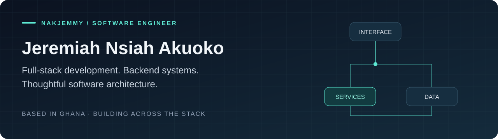

  

  <a href="https://www.linkedin.com/in/nakjemmy/">LinkedIn</a> &nbsp;·&nbsp;
  <a href="https://dev.to/nakjemmy">Writing</a> &nbsp;·&nbsp;
  <a href="https://stackoverflow.com/users/7453378">Stack Overflow</a> &nbsp;·&nbsp;
  <a href="https://x.com/nakjemmy">X</a>

## Hi, I'm Jeremiah 👋

I'm a software engineer from Ghana, working across **full-stack development, backend engineering, and software architecture**. My toolkit spans JVM services, modern web applications, mobile experiences, and cloud infrastructure.

I enjoy connecting the pieces: clear APIs, well-defined service boundaries, useful interfaces, and maintainable systems.

### My engineering toolkit

| Area | Technologies & focus |
| :--- | :--- |
| **Backend & JVM** | Java · Spring Boot · Scala · Akka · Kotlin |
| **Web applications** | TypeScript · JavaScript · React · Next.js · tRPC |
| **PHP ecosystem** | PHP · Laravel |
| **Mobile** | Flutter · Dart · Android |
| **Cloud & delivery** | AWS · Docker · Docker Compose · Linux · Git |
| **Data** | PostgreSQL · MySQL · MongoDB · SQLite · DynamoDB |
| **Architecture** | API design · Microservices · Serverless applications · Service boundaries |

<strong>More tools I've worked with</strong>

Vue · Angular · Node.js · Express · Python · Firebase · cPanel

### A few things to explore

A selection of public projects and learning work across cloud applications and reusable models.

| Project | What you'll find |
| :--- | :--- |
| [**Serverless Recipe App**](https://github.com/nakjemmy/udacity-cdev-final-project) | A React application with a TypeScript backend, authenticated recipe management, AWS Lambda, API Gateway, DynamoDB, and S3. |
| [**Udagram**](https://github.com/nakjemmy/udagram-project) | A cloud development project with Angular/Ionic, Node.js/Express APIs, PostgreSQL, and Docker Compose services for users, feeds, and a reverse proxy. |
| [**Google Maps Models**](https://github.com/nakjemmy/google_maps_models) | Dart models for Google Maps, with JSON serialization tooling and a test/lint workflow. |

### What keeps me curious

- **Scala & the JVM** — functional programming and backend system design.
- **Distributed systems** — how services communicate, handle failure, and stay understandable.
- **Cloud architecture** — containers, serverless patterns, and the trade-offs behind deployment choices.

---

  <strong>Let's talk software, systems, and the details that make them work.</strong> 
  <a href="https://www.linkedin.com/in/nakjemmy/">Connect on LinkedIn</a> &nbsp;·&nbsp;
  <a href="https://github.com/nakjemmy?tab=repositories">Explore my repositories</a>

